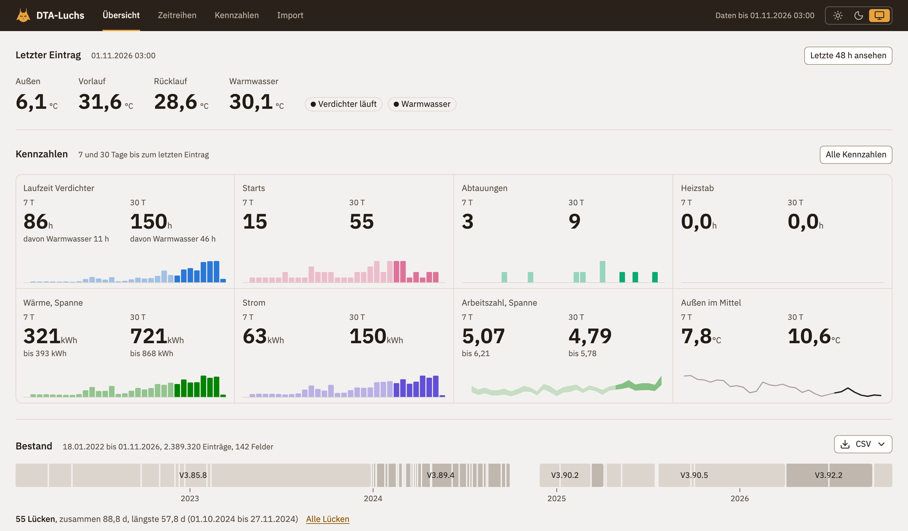
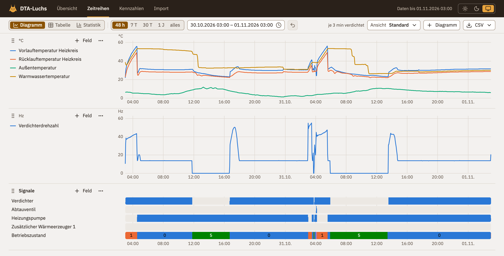
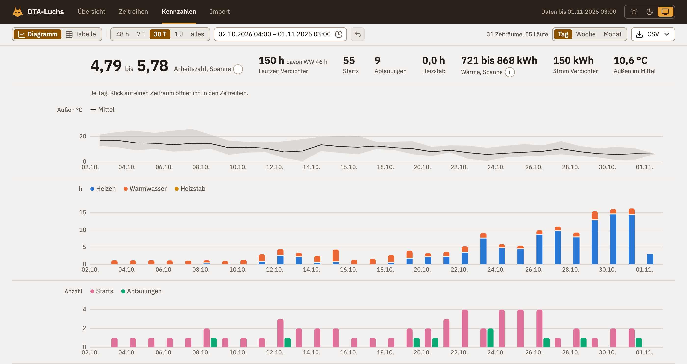

# DTA-Luchs

Auswertung für Wärmepumpen mit Luxtronik-Steuerung.

Die Steuerung protokolliert jede Minute Temperaturen, Betriebszustände sowie Ein- und Ausgänge der Wärmepumpe, hält davon aber nur die letzten 48 Stunden vor. DTA-Luchs sammelt diese DTA-Dateien und zeigt, wie die Anlage über Monate und Jahre läuft.

Die Luxtronik-Steuerung steckt in Wärmepumpen unter anderem von Alpha Innotec, Siemens, Novelan, Roth, Elco, Buderus, Nibe und Wolf Heiztechnik (Liste nach der [Luxtronik-Integration für Home Assistant](https://github.com/BenPru/luxtronik#-compatibility)).

Dieses Repo ist DTA-Luchs zum Selbsthosten: auf dem eigenen Rechner, dem NAS oder im Homelab, mit Docker oder als App in Home Assistant. Die Daten bleiben bei dir. Wer keinen Server betreiben will, nutzt DTA-Luchs gehostet unter [dtaluchs.de](https://dtaluchs.de), kostenlos und mit derselben Auswertung.

## Was DTA-Luchs zeigt



- **Übersicht:** der letzte Stand der Anlage und wie sie in den letzten 7 und 30 Tagen gearbeitet hat.
- **Zeitreihen:** Temperaturen, Betriebszustände, Ein- und Ausgänge als Kurven, frei kombinierbar, von 48 Stunden bis zu allen Jahren. Zustand und Abschaltgrund stehen im Klartext daneben. Ansichten lassen sich speichern.
- **Kennzahlen:** Starts und Laufzeit des Verdichters, Abtauungen, Wärme und Strom, je Tag, Woche oder Monat.
- **Statistik je Feld** über einen gewählten Zeitraum.
- **Export als CSV**, Minutenwerte für jeden Zeitraum.
- **Grafana:** Anbindung über die JSON-API, mit Beispiel-Dashboard ([Anleitung](docs/anleitung-grafana.md)).





DTA-Luchs liest die DTA-Formate 9003 und 8209, die die aktuellen Firmware-Stände der Luxtronik schreiben. Die älteren Formate 8208, 9000 und 9001 liest es nicht. In die Steuerung greift DTA-Luchs nie ein, es liest nur.

## Wie die Daten hinkommen

Drei Wege, die sich auch kombinieren lassen:

- **Abruf von der Steuerung:** Auf der Seite **Import** trägst du die Adresse der Steuerung ein. DTA-Luchs holt die DTA-Datei dann kurz nach jeder Sicherung der Steuerung selbst.
- **Ordner im Takt:** DTA-Luchs liest regelmäßig einen Ordner mit DTA-Dateien ein, etwa eine Freigabe auf dem NAS, in die ein anderes Programm die Dateien legt. Ein Skript, das die Datei per Cron von der Steuerung holt, liegt unter [`contrib/abruf/`](contrib/abruf/README.md). Es braucht nur sh und curl und läuft auch, wenn DTA-Luchs gerade nicht läuft.
- **Upload:** Alte DTA-Dateien ziehst du auf die Seite **Import**, auch viele auf einmal. Doppelte Einträge übernimmt DTA-Luchs nur einmal.

## Gehostet oder self-hosted

| | Gehostet ([dtaluchs.de](https://dtaluchs.de)) | Self-hosted (dieses Repo) |
|---|---|---|
| Kurven, Kennzahlen, Ereignisse, Klartexte | ✓ | ✓ |
| Export als CSV | ✓ | ✓ |
| DTA-Dateien hochladen | ✓ | ✓ |
| Daten von der Steuerung holen | per Skript im Heimnetz | direkt von der Steuerung |
| App für Home Assistant, Grafana | – | ✓ |
| Anlagen | beliebig viele in einem Konto | eine je Installation |
| Anlage mit Personen teilen, öffentlicher Link | ✓ | – |
| Anmeldung | Konto mit E-Mail-Adresse | keine, nur im Heimnetz betreiben |
| Betrieb, Updates, Sicherung | machen wir | machst du |

## Schnellstart mit Docker

Voraussetzung: Docker mit Compose, ein Rechner mit arm64 oder x86-64 mit AVX2 (unter Proxmox den CPU-Typ `x86-64-v3` oder `host` wählen).

```sh
git clone https://github.com/siedi/dtaluchs.git
cd dtaluchs
mkdir data && sudo chown -R 10001:10001 data
docker compose up -d
```

Danach ist DTA-Luchs unter `http://<rechner>:8470` erreichbar. Beim ersten Start baut Compose das Image aus dem Quelltext, das dauert einige Minuten. Liegen deine DTA-Dateien schon in einem Ordner, trägst du ihn in `compose.yaml` statt `./dta` ein; DTA-Luchs liest ihn nur. Alle Einstellungen stehen kommentiert (englisch) in [`compose.yaml`](compose.yaml).

Das fertige Image für amd64 und arm64 liegt unter `ghcr.io/siedi/dtaluchs`, mit der Version als Tag und `latest`.

DTA-Luchs hat keine Anmeldung, und Port 8470 ist im ganzen Netz erreichbar. Betreibe es deshalb nur im Heimnetz oder hinter einem Proxy mit Anmeldung.

## Home Assistant

Die App läuft unter Home Assistant OS. Home Assistant Container kennt keine Apps; dort nimmst du den Weg über Docker.

Unter **Settings** > **Apps** > **Install app** > **Repositories** fügst du `https://github.com/siedi/dtaluchs` hinzu, oder direkt über [diesen Link](https://my.home-assistant.io/redirect/supervisor_add_addon_repository/?repository_url=https%3A%2F%2Fgithub.com%2Fsiedi%2Fdtaluchs). Danach steht die App **DTA-Luchs** im Store, Einzelheiten in der [Doku der App](contrib/home-assistant/dtaluchs/DOCS.md). Sie erscheint über Ingress in der Seitenleiste und holt die DTA-Datei selbst von der Steuerung. Der Bestand ist Teil jeder Sicherung von Home Assistant.

## Ohne Docker

Voraussetzung: [uv](https://docs.astral.sh/uv/) (holt Python 3.14 selbst) und Node.js 24.

```sh
cp dtaluchs.example.toml dtaluchs.toml   # unter [import] source den Ordner mit den DTA-Dateien eintragen
./dtaluchs import                        # Bestand einlesen
./dtaluchs serve                         # http://127.0.0.1:8470
```

Was sich einstellen lässt, steht kommentiert (englisch) in [`dtaluchs.example.toml`](dtaluchs.example.toml).

## Mitarbeiten

Fehler und Wünsche meldest du als Issue, auf Deutsch oder Englisch. Wie ein Pull Request aussieht, steht in [`CONTRIBUTING.md`](CONTRIBUTING.md), die Regeln für den Code in [`CONVENTIONS.md`](CONVENTIONS.md), beide englisch. Das Backend ist in Python geschrieben, mit FastAPI, DuckDB und Parquet, das Frontend in React. `./dtaluchs check` prüft alles in einem Lauf.

## Hinweise

DTA-Luchs ist ein Werkzeug zum Nachsehen, ohne Gewähr. Einstellungen an der Anlage stimmst du mit deinem Fachbetrieb ab.

DTA-Luchs ist ein unabhängiges Projekt und steht in keiner Verbindung zu den Herstellern der Luxtronik-Steuerung oder der Wärmepumpen. Genannte Produkt- und Markennamen gehören ihren Inhabern.

## Lizenz

[Apache-2.0](LICENSE)
