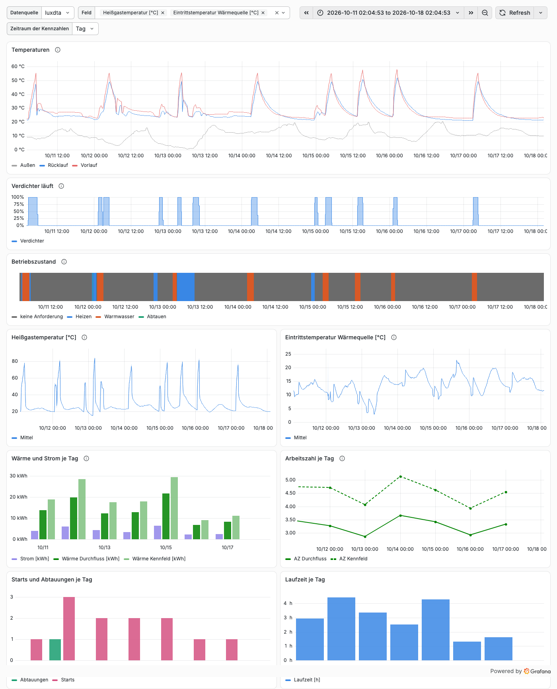
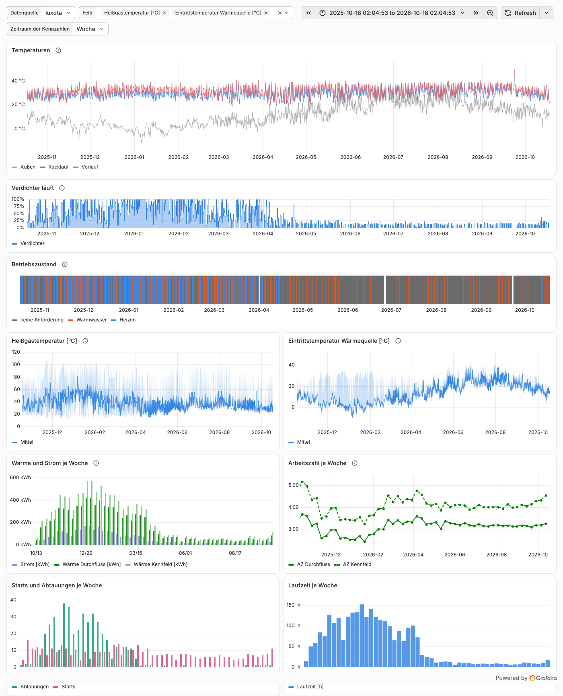
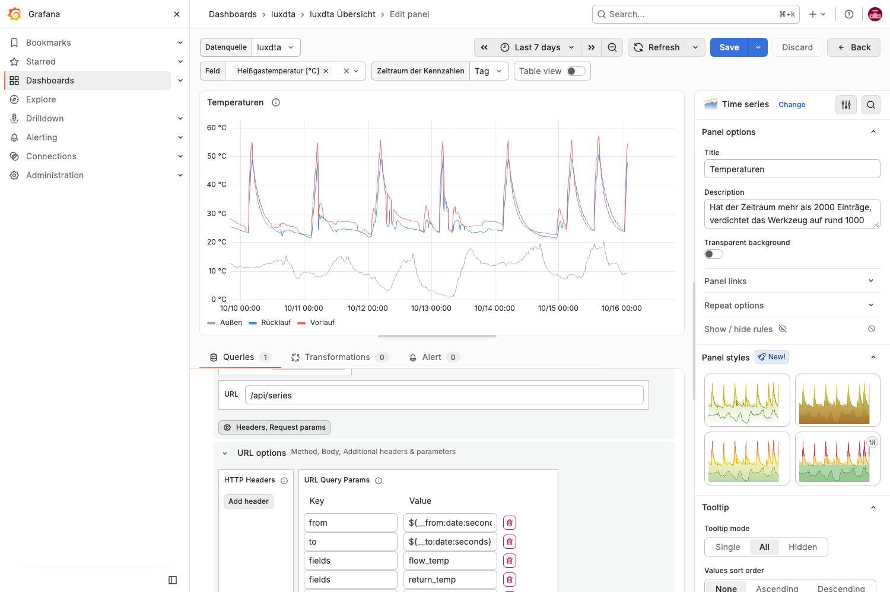

# Anleitung: dtaluchs in Grafana

Grafana liest die Werte über die Datasource Infinity direkt aus der API von dtaluchs. Es braucht keine zweite Datenbank und keinen Export. Die Werte kommen umgerechnet an, wie in der Oberfläche, und bei langen Zeiträumen verdichtet.

Getestet mit Grafana 13.2.4 und Infinity 4.1.1.



## 1. Neu aufsetzen mit Docker Compose

Für alle, die dtaluchs mit der `compose.yaml` im Stammordner des Repos betreiben. `contrib/grafana/compose.yaml` ergänzt sie um Grafana mit Infinity, der Datasource und dem Beispiel-Dashboard.

1. Im Stammordner des Repos starten:

   ```sh
   docker compose -f compose.yaml -f contrib/grafana/compose.yaml up -d
   ```

2. `http://<rechner>:3000` öffnen und mit `admin` und Passwort `admin` anmelden. Grafana verlangt dabei ein neues Passwort. Diesen Schritt nicht mit „Skip“ überspringen, sonst bleibt `admin`/`admin` im Netz gültig.
3. Unter Dashboards den Ordner `dtaluchs` und darin „dtaluchs Übersicht“ öffnen.

Port 3000 ist im ganzen Netz erreichbar, über Grafana auch dtaluchs. Beides nur im Heimnetz betreiben.

Grafana spricht dtaluchs im Compose-Netz unter `http://dtaluchs:8470` an. Wer dtaluchs nur über Grafana nutzt, kann den Eintrag `ports` beim Dienst `dtaluchs` streichen; dann ist dtaluchs von außen nicht mehr erreichbar.

## 2. Vorhandenes Grafana

1. **Infinity installieren:** unter Administration, Plugins, „Infinity“ suchen und installieren. Im Container geht es auch über die Umgebung: `GF_PLUGINS_PREINSTALL_SYNC=yesoreyeram-infinity-datasource@4.1.1`.
2. **Datasource anlegen:** Connections, Data sources, Infinity. Name `dtaluchs`, unter URL die Adresse von dtaluchs aus Sicht von Grafana, etwa `http://<rechner>:8470`. Speichern. Eine Liste erlaubter Hosts braucht es nicht, solange die URL gesetzt ist.
3. **Dashboard importieren:** Dashboards, New, Import, die Datei `contrib/grafana/dashboards/dtaluchs.json` hochladen. Oben im Dashboard unter „Datenquelle“ die Datasource aus Schritt 2 wählen.

Wer Grafana per Provisioning einrichtet, nimmt die Dateien unter `contrib/grafana/provisioning/`. Die Datasource liest die Adresse aus der Umgebungsvariable `DTALUCHS_URL`.

## 3. Das Beispiel-Dashboard

| Panel | Quelle | Inhalt |
|---|---|---|
| Temperaturen | `/api/series` | Vorlauf, Rücklauf, Außen |
| Verdichter läuft | `/api/series` | Anteil der Einträge je Intervall, in denen der Verdichter lief |
| Betriebszustand | `/api/series` | Was die Anlage tut, als Band über die Zeit: Heizen, Warmwasser, Abtauen, keine Anforderung und weitere |
| ein Panel je Feld | `/api/series` | Mittel, dazu min und max als Band; Felder oben unter „Feld“ wählen |
| Wärme und Strom | `/api/stats` | Wärme aus Durchfluss und Spreizung, Wärme laut Steuerung (Kennfeld), Strom des Verdichters |
| Arbeitszahl | `/api/stats` | aus Durchfluss (Linie) und laut Steuerung (gestrichelt) |
| Starts und Abtauungen, Laufzeit | `/api/stats` | Anzahl und Stunden |



Die Panels aus `/api/stats` zeigen je Tag, Woche oder Monat, Auswahl oben unter „Zeitraum der Kennzahlen“. Sie nutzen eine gemeinsame Abfrage: Das Panel „Wärme und Strom“ fragt dtaluchs, die übrigen nehmen sein Ergebnis über die Datasource „-- Dashboard --“. Wer „Wärme und Strom“ in einer Kopie ändert, ändert damit, was die anderen drei Panels bekommen.

Tage, Wochen und Monate beginnen um Mitternacht in der Zone der Anlage (Einstellung `timezone` von dtaluchs). Der erste und der letzte Zeitraum sind angeschnitten, wenn der Zeitbereich nicht auf einer Grenze beginnt oder endet; ihre Balken sind dann kürzer. Voreingestellt ist `now-7d/d` bis `now`, also ab Mitternacht vor sieben Tagen. Grafana rundet dabei in der Zone des Dashboards. Steht sie auf „Browser“ und liegt der Browser in einer anderen Zone als die Anlage, die Zone unter Edit, Settings, Time options, Time zone auf die der Anlage stellen und als Kopie speichern (unten).

Das Dashboard aus dem Provisioning lässt sich in der Oberfläche nicht überschreiben. Eigene Änderungen mit „Save as“ als Kopie speichern, sonst gingen sie beim nächsten Update der Datei verloren.

## 4. Eigene Panels

Jedes Panel ist eine Infinity-Abfrage vom Typ JSON auf einen Pfad der API, umgeformt mit dem Parser jq. Am einfachsten ein Panel des Beispiels duplizieren und anpassen.

### Zeitreihen: `/api/series`



| Einstellung | Wert |
|---|---|
| Type | JSON |
| Parser | JQ |
| Source | URL |
| Format | Time Series |
| Method, URL | GET, `/api/series` |
| Headers, Request params, darin URL Query Params | `from` = `${__from:date:seconds}`, `to` = `${__to:date:seconds}`, `fields` = ID des Felds, eine Zeile je Feld, `points` = `1000` |

Unter „Parsing options & Result fields“, Feld „Rows/Root“, für zwei Felder:

```jq
. as $d
| ($d.series[] | select(.field == "flow_temp") | .value) as $flow
| ($d.series[] | select(.field == "outdoor_temp") | .value) as $out
| [range(0; $d.ts | length) as $i | {time: $d.ts[$i], flow: $flow[$i], out: $out[$i]}]
```

Darunter unter „Columns“: Selector `time` „as“ „Time ( UNIX s )“, `flow` und `out` als „Number“. Bei verdichteten Messwerten liegen neben `.value` auch `.min` und `.max` je Intervall.

Die ID eines Felds liefert `/api/meta`:

```sh
curl -s http://<rechner>:8470/api/meta | jq -r '.fields[] | "\(.id)\t\(.label.de) [\(.unit // "")]"'
```

Was die Werte bedeuten:

- **Messwerte:** das Mittel je Intervall, `min` und `max` daneben.
- **Bits** wie `compressor_1`: ungefiltert 0 oder 1, verdichtet der Anteil von 0 bis 1. In Grafana die Einheit „Percent (0.0-1.0)“ wählen.
- **Zustände** wie `operating_state`: in `.value` der Code, dazu der Text in `.texts` und je Zeile in `.text` die Stelle darin (`null` ohne Text). Verdichtet steht der häufigste Zustand im Intervall. Dazu kommen in `.sections` alle Abschnitte im Zeitraum mit `start`, `end`, `value` (Code) und `text` (Stelle in `.texts`), auch verdichtet, solange es nicht mehr als doppelt so viele wie `points` sind; sonst ist `.sections` `null`. Den Text je Abschnitt, ein Ende ohne Wert, wo der nächste Abschnitt nicht anschließt, und ohne Abschnitte die Zeilen liefert:

  ```jq
  . as $d | $d.series[0] as $s
  | if $s.sections == null then
      [range(0; $d.ts | length) as $i | {time: $d.ts[$i], zustand:
        (if $s.value[$i] == null then null
         elif $s.text[$i] == null then ($s.value[$i] | floor | tostring)
         else $s.texts[$s.text[$i]] end)}]
    else $s.sections as $c
      | [range(0; $c.start | length) as $i
         | {time: $c.start[$i], zustand:
             (if $c.text[$i] == null then ($c.value[$i] | floor | tostring) else $s.texts[$c.text[$i]] end)},
           (if $i == ($c.start | length) - 1 or $c.end[$i] < $c.start[$i + 1]
            then {time: $c.end[$i], zustand: null} else empty end)]
    end
  ```

  `zustand` unter „Columns“ als „String“, Panel „State timeline“. Die Farben setzt man unter Value mappings je Text.
- **Zeit:** Verdichtet steht der Beginn des Intervalls.
- **Lücken:** Wo die DTA-Dateien eine Lücke haben, steht eine Zeile ohne Werte, die Linie bricht dort ab.

### Kennzahlen: `/api/stats`

URL `/api/stats`, Parameter `from`, `to` wie oben und `period` = `day`, `week` oder `month`. Die Antwort hat je Größe eine Liste, eine Stelle je Zeitraum:

```jq
[range(0; .start | length) as $i
 | {time: .start[$i], heat: .heat_flow_kwh[$i], electric: .electric_kwh[$i], cop: .cop_flow[$i]}]
```

Weitere Listen: `heat_reported_kwh`, `cop_reported`, `starts`, `defrosts`, `run_s`, `run_dhw_s`, `defrost_s`, `aux_heater_s`, `outdoor_mean`, `outdoor_min`, `outdoor_max`. Zeiten in Sekunden, Wärme und Strom in kWh.

## 5. Grenzen

- **CSV nicht nehmen.** Die CSV-Ausgabe der API (`format=csv`) ist für Tabellenprogramme gedacht: Dezimalkomma und Zeit ohne Zone. Infinity liest Werte mit Komma als leer und verschiebt die Zeit um den Abstand der Zone zu UTC. Deshalb JSON nehmen.
- **jq statt JSONata.** Beide Parser liefern dieselben Werte. Für dieselbe Umformung brauchte JSONata 0,6 bis 1,4 s, jq unter 0,2 s.
- **Punkte und Felder:** `points` von 100 bis 12 000, höchstens 36 Felder je Abfrage. Hat der Zeitraum mehr als doppelt so viele Einträge wie `points`, verdichtet dtaluchs auf rund `points` Intervalle.
- **Zustände über lange Zeiträume:** Mit `.sections` zeigt ein Zustandspanel jeden Abschnitt, auch ein Abtauen von 2 Minuten in einem Jahr. Die Grenze ist das Doppelte von `points`: Mit `points=4000` (wie im Beispiel) passt `operating_state` über den ganzen Bestand, mit `points=1000` schon über ein Jahr nicht mehr. Darüber gilt je Intervall der häufigste Zustand, und kurze Zustände fallen weg.
- **Minutenwerte** gibt es nur als CSV, sie gehen deshalb nicht in Grafana.
- **Fehler** zeigt Grafana nur mit Statuscode, etwa „status code : 422“. Den Text liefert dieselbe URL im Browser.
- **Anmeldung:** dtaluchs hat keine. Wer Grafana erreicht, sieht alle Werte, wer dtaluchs erreicht, ebenso.

## 6. Fehlersuche

| Meldung im Panel | Ursache |
|---|---|
| `status code : 422` | Abfrage ungültig, etwa ein Feld, das es nicht gibt, oder `from` nach `to`. Die URL im Browser aufrufen, die Antwort nennt den Grund |
| `no response received` mit `connection refused` | URL der Datasource stimmt nicht oder dtaluchs läuft nicht. Im Compose-Netz `http://dtaluchs:8470`, sonst Rechner und Port von dtaluchs |
| No data | Im Zeitraum gibt es keine Einträge |
| Linie fehlt, kein Fehler | Der Selector unter „Columns“ passt nicht zum Namen im jq-Ausdruck, die Spalte bleibt leer |
